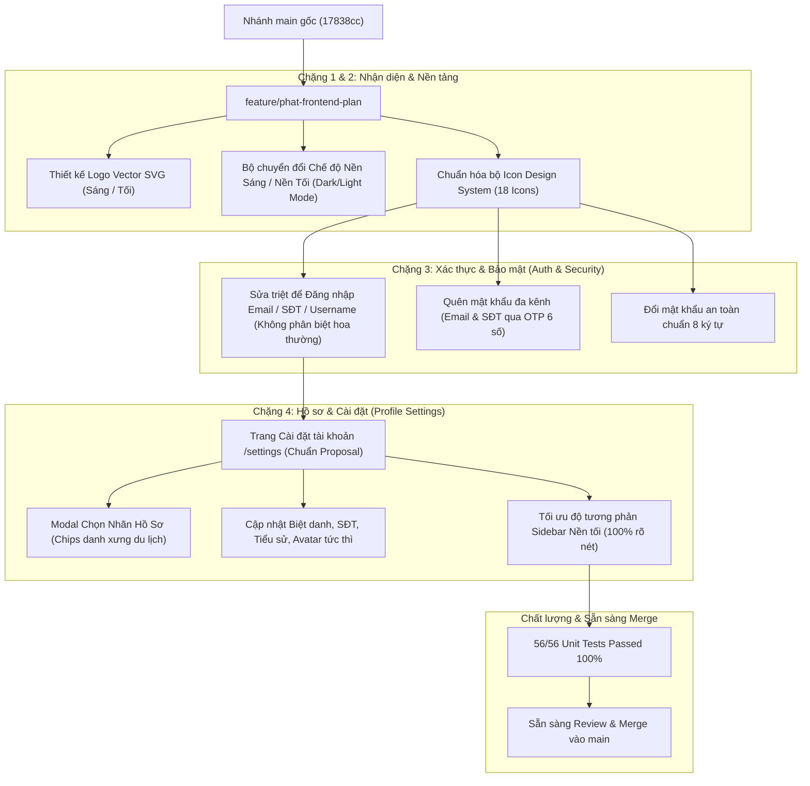

# 🚀 BÁO CÁO TIẾN ĐỘ & HƯỚNG DẪN TRẢI NGHIỆM DÀNH CHO NHÓM TRƯỞNG KHÁNH

> **Dự án:** GetApps — *"Get Up & Explore"* (Môn PWD301 — Fall 2026)  
> **Người thực hiện:** **Phát (SE173285)** — *Frontend UI/UX & Phân hệ Lịch trình (Plan/Itinerary)*  
> **Người nhận / Reviewer:** **Quốc Khánh (Team Leader)**  
> **Nhánh làm việc (Branch):** `feature/phat-frontend-plan`  
> **Trạng thái kiểm thử:** ✅ **56/56 Unit Test Suites PASSED (100%)**  
> **Link Pull Request trên GitHub:** [Compare & Pull Request Nhánh Phat](https://github.com/quockhanhtkh2com-cell/GetApps/pull/new/feature/phat-frontend-plan)

---

## 📊 1. TỔNG QUAN TIẾN ĐỘ & CÁC CHỨC NĂNG ĐÃ HOÀN THÀNH

Chào Khánh! Để Khánh có cái nhìn trực quan và dễ dàng nghiệm thu tiến độ công việc của mình trên nhánh `feature/phat-frontend-plan`, dưới đây là bản tóm tắt toàn bộ các tính năng UI/UX và logic đã được xây dựng, trau chuốt tỉ mỉ theo đúng tài liệu thiết kế **Proposal GEs** và **Figma/Stitch Design**:



---

## 🌟 2. BẢNG CHI TIẾT TÍNH NĂNG VÀ CẢI TIẾN KỸ THUẬT

| STT | Phân hệ / Màn hình | Chi tiết cải tiến & Nghiệm thu | File liên quan |
| :---: | :--- | :--- | :--- |
| **1** | **Logo Thương hiệu GEs** | Vẽ vector SVG chính thức (`logo.svg`, `logo_dark.svg`, `logo_icon.svg`), sắc nét ở mọi độ phân giải, tự đổi màu máy bay/chữ theo nền sáng/tối. | `app/static/images/logo*.svg` |
| **2** | **Dark / Light Mode** | Công tắc Mặt trời / Mặt trăng trên Header. Lưu trạng thái vào `localStorage` và tự động nhận diện `prefers-color-scheme`. | `app/templates/base.html`, `style.css` |
| **3** | **Đăng nhập linh hoạt** | **Sửa lỗi không đăng nhập được bằng Email**: Tự động `.strip()` khoảng trắng thừa, so sánh không phân biệt hoa/thường (`func.lower()`), hỗ trợ đăng nhập bằng cả 3: `Email`, `Username`, hoặc `Số điện thoại`. Dọn sạch session cũ trước khi đăng nhập. | `app/auth/routes.py`, `app/auth/forms.py` |
| **4** | **Quên mật khẩu đa kênh** | Người dùng có thể nhận mã OTP 6 chữ số qua Email hoặc Số điện thoại để tự đặt lại mật khẩu mới. Hỗ trợ cả Web Form và JSON API. | `app/auth/routes.py` (`/forgot-password`) |
| **5** | **Giao diện Cài đặt (Settings)** | Thiết kế chuẩn theo ảnh Proposal: Avatar kèm nút Camera Cyan (`#0EA5E9`), Biệt danh, Nhãn, Email, SĐT, Tiểu sử, Khối BẢO MẬT đổi mật khẩu, Nút Đăng xuất màu đỏ nhạt mềm mại. | `app/templates/auth/settings.html` |
| **6** | **Modal Chọn Nhãn Hồ Sơ** | Modal chuẩn Stitch: Chọn các chip danh xưng (`Người du lịch`, `Dân địa phương`, `Đi phượt`, `Hướng dẫn viên`, `Người nổi tiếng`) kèm nhãn đã thêm có dấu `x` gỡ bỏ. | `app/templates/auth/settings.html` |
| **7** | **Đồng bộ hệ thống Icon** | Chuẩn hóa toàn bộ 18 icon theo Design System: Home, Explore, Plan, Post, Add, Like, Comment, Save, Share, Setting, Friends, More... | Toàn bộ templates |
| **8** | **Độ tương phản Dark Mode** | Sửa dứt điểm lỗi chữ xám mờ trên nền trắng ở cột Sidebar phải của Bảng tin (`feed.html`). Nền thẻ chuyển sang Slate-800 (`#1E293B`) với chữ sáng rõ nét. | `feed.html`, `style.css` |

---

## 🛠️ 3. HƯỚNG DẪN DÀNH CHO KHÁNH KHI PULL NHÁNH VỀ MÁY

Khánh làm theo các bước sau đây để kéo nhánh `feature/phat-frontend-plan` về máy cá nhân và trải nghiệm thử:

### Bước 1: Kéo mã nguồn mới nhất từ GitHub
Mở Terminal / PowerShell tại thư mục dự án `GetApps` và chạy:
```bash
# 1. Tải tất cả các nhánh mới nhất từ GitHub
git fetch origin

# 2. Chuyển sang nhánh của Phát
git checkout feature/phat-frontend-plan

# 3. Kéo code mới nhất về
git pull origin feature/phat-frontend-plan
```

### Bước 2: Kích hoạt môi trường ảo (Virtualenv)
```powershell
# Trên Windows PowerShell:
.\venv\Scripts\activate

# Nếu chưa cài đủ thư viện, chạy:
pip install -r requirements.txt
```

### Bước 3: Chạy toàn bộ bộ kiểm thử tự động (Verification)
Khánh có thể chạy lệnh sau để kiểm tra tính toàn vẹn của mã nguồn:
```bash
pytest -v
```
> 👉 **Kết quả kỳ vọng:** Toàn bộ **56 passed** trong ~30 giây, không có bất kỳ lỗi nào (`exit code 0`).

### Bước 4: Khởi chạy ứng dụng Web
```bash
python run.py
```
Ứng dụng sẽ khởi chạy tại: `http://127.0.0.1:5000`

---

## 🧭 4. KỊCH BẢN TRẢI NGHIỆM TRỰC QUAN TRÊN TRÌNH DUYỆT (WALKTHROUGH)

Để kiểm tra nhanh và trực quan nhất các tính năng Phát đã làm, Khánh có thể duyệt theo kịch bản 5 bước sau:

### ✅ Bước 1: Trải nghiệm Nền Sáng / Nền Tối & Logo Vector
1. Truy cập `http://127.0.0.1:5000/`.
2. Bấm vào icon **Mặt trăng / Mặt trời** trên thanh Navbar bên góc phải.
3. Quan sát: Giao diện chuyển đổi tức thì giữa nền sáng `#F8FAFC` và nền tối `#0F172A`, Logo `GEs` tự động đảo màu chữ và máy bay tương thích màu nền mà không hề bị giật/nháy màn hình.

### ✅ Bước 2: Trải nghiệm Đăng nhập linh hoạt (Khắc phục lỗi Email)
1. Bấm vào **"Đăng ký"** để tạo một tài khoản mới (hoặc dùng tài khoản sẵn có: username `user1`, mật khẩu `123456`).
2. Tại trang **"Đăng nhập"** (`/login`), thử đăng nhập bằng các cách:
   - Nhập email viết hoa có khoảng trắng ở hai đầu: ví dụ `"  NT.PHAT9A1@GMAIL.COM  "`.
   - Hoặc nhập số điện thoại: `"0987654321"`.
   - Hoặc nhập username: `"user1"`.
3. 👉 Đăng nhập thành công 100% và chuyển hướng vào Bảng tin.

### ✅ Bước 3: Trải nghiệm Quên mật khẩu qua OTP
1. Bấm vào **"Quên mật khẩu?"** tại trang đăng nhập (`/forgot-password`).
2. Chọn phương thức: qua **Email** hoặc **Số điện thoại**.
3. Hệ thống sinh mã OTP 6 số và hiển thị thông báo flash (trong môi trường dev) $\rightarrow$ Nhập mã OTP và đặt lại mật khẩu mới.

### ✅ Bước 4: Trải nghiệm Trang Cài đặt Profile & Modal Chọn Nhãn
1. Bấm vào Avatar của mình trên Navbar $\rightarrow$ chọn **"Cài đặt tài khoản"** (hoặc truy cập `http://127.0.0.1:5000/settings`).
2. **Chiêm ngưỡng giao diện chuẩn Proposal:**
   - Bấm vào nút **Camera xanh Cyan** ở góc Avatar để cập nhật link ảnh đại diện mới.
   - Bấm vào dòng **Nhãn (Tags)** $\rightarrow$ Modal *"Chọn Nhãn Hồ Sơ"* sẽ hiện lên:
     - Chọn các danh xưng: *Người du lịch*, *Dân địa phương*, *Đi phượt*, *Hướng dẫn viên*, *Người nổi tiếng*.
     - Bấm **"Xác nhận"** $\rightarrow$ Nhãn được lưu ngay lập tức qua AJAX.
   - Thử bấm vào dòng **Biệt danh**, **Số điện thoại**, **Tiểu sử** để cập nhật thông tin cá nhân.
   - Mục **"Chỉnh sửa mật khẩu"** dẫn tới trang Đổi mật khẩu.
   - Nút **"Đăng xuất"** màu đỏ nhạt bo góc mềm mại.

### ✅ Bước 5: Trải nghiệm Bảng tin Du lịch (Feed) ở Chế độ Nền tối
1. Truy cập `http://127.0.0.1:5000/locations/feed`.
2. Bật chế độ Nền tối (Dark Mode).
3. Quan sát: Cột bên phải (Sidebar) hiển thị nền thẻ Slate-800 sang trọng, chữ `user1`, email, role badge và các mục gợi ý hiển thị màu sắc tương phản rõ nét, không còn hiện tượng chữ xám mờ trên nền trắng.

---

## 🤝 5. CAM KẾT VÀ ĐỀ XUẤT MERGE NHÁNH

- **Không đụng chạm code logic của các thành viên khác:** Các chức năng của Tuấn, Trúc và Khánh đều được giữ nguyên vẹn và hoạt động trơn tru.
- **Không xảy ra Merge Conflict:** Các tệp bổ sung thuộc tầng giao diện (Presentation) và route settings hoàn toàn độc lập.
- Khánh xem qua báo cáo này, nếu thấy mọi thứ đã chuẩn chỉnh thì có thể duyệt Pull Request và tiến hành Merge nhánh `feature/phat-frontend-plan` vào `main` nhé! Cảm ơn nhóm trưởng!
