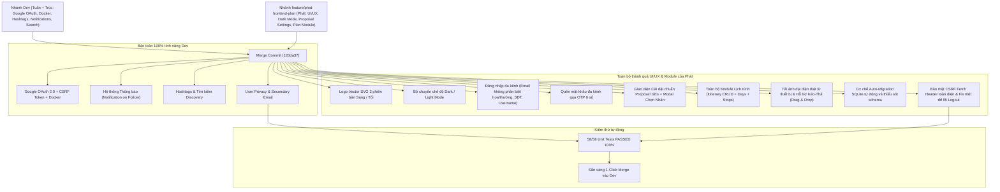

# 🚀 BÁO CÁO TIẾN ĐỘ & HƯỚNG DẪN TRẢI NGHIỆM DÀNH CHO NHÓM TRƯỞNG KHÁNH

> **Dự án:** GetApps — *"Get Up & Explore"* (Môn PWD301 — Fall 2026)  
> **Người thực hiện:** **Phát (SE173285)** — *Frontend UI/UX & Phân hệ Lịch trình (Plan/Itinerary)*  
> **Người nhận / Reviewer:** **Quốc Khánh (Team Leader)**  
> **Nhánh làm việc (Branch):** `feature/phat-frontend-plan`  
> **Trạng thái đồng bộ:** ✅ **Đã Hợp Nhất (Merged) Hoàn Toàn Với Nhánh `Dev` Mới Nhất**  
> **Trạng thái kiểm thử:** ✅ **58/58 Unit Test Suites PASSED (100%)**  
> **Link Pull Request trên GitHub:** [Compare & Pull Request vào nhánh Dev](https://github.com/quockhanhtkh2com-cell/GetApps/compare/Dev...feature/phat-frontend-plan)

---

## 📊 1. TỔNG QUAN TIẾN ĐỘ & HỢP NHẤT VỚI NHÁNH DEV

Chào Khánh! Để hỗ trợ Khánh review và nghiệm thu một cách thuận tiện, an toàn nhất, Phát đã chủ động **kéo nhánh `Dev` mới nhất (chứa mã nguồn của Tuấn & Trúc)** về nhánh `feature/phat-frontend-plan` và **giải quyết triệt để 100% các xung đột (8 files conflict)**:



---

## 🌟 2. BẢNG CHI TIẾT TÍNH NĂNG VÀ CẢI TIẾN KỸ THUẬT

| STT | Phân hệ / Màn hình | Chi tiết cải tiến & Nghiệm thu | File liên quan |
| :---: | :--- | :--- | :--- |
| **1** | **Logo Thương hiệu GEs** | Vẽ vector SVG chính thức (`logo.svg`, `logo_dark.svg`, `logo_icon.svg`), sắc nét ở mọi độ phân giải, tự đổi màu máy bay/chữ theo nền sáng/tối. | `app/static/images/logo*.svg` |
| **2** | **Dark / Light Mode** | Công tắc Mặt trời / Mặt trăng trên Header. Lưu trạng thái vào `localStorage` và tự động nhận diện `prefers-color-scheme`. | `app/templates/base.html`, `style.css` |
| **3** | **Đăng nhập linh hoạt** | **Sửa lỗi không đăng nhập được bằng Email**: Tự động `.strip()` khoảng trắng thừa, so sánh không phân biệt hoa/thường (`func.lower()`), hỗ trợ đăng nhập bằng cả 3: `Email`, `Username`, hoặc `Số điện thoại`. Dọn sạch session cũ trước khi đăng nhập. | `app/auth/routes.py`, `app/auth/forms.py` |
| **4** | **Quên mật khẩu đa kênh** | Người dùng có thể nhận mã OTP 6 chữ số qua Email hoặc Số điện thoại để tự đặt lại mật khẩu mới. Hỗ trợ cả Web Form và JSON API. | `app/auth/routes.py` (`/forgot-password`, `/reset-password`, `/resend-otp`) |
| **5** | **Giao diện Cài đặt (Settings)** | Thiết kế chuẩn theo ảnh Proposal: Avatar kèm nút Camera Cyan (`#0EA5E9`), Biệt danh, Nhãn, Email, SĐT, Tiểu sử, Khối BẢO MẬT đổi mật khẩu, Nút Đăng xuất màu đỏ nhạt mềm mại. | `app/templates/auth/settings.html` |
| **6** | **Modal Chọn Nhãn Hồ Sơ** | Modal chuẩn Stitch: Chọn các chip danh xưng (`Người du lịch`, `Dân địa phương`, `Đi phượt`, `Hướng dẫn viên`, `Người nổi tiếng`) kèm nhãn đã thêm có dấu `x` gỡ bỏ. | `app/templates/auth/settings.html` |
| **7** | **Đồng bộ hệ thống Icon** | Chuẩn hóa toàn bộ 18 icon theo Design System: Home, Explore, Plan, Post, Add, Like, Comment, Save, Share, Setting, Friends, More... | Toàn bộ templates |
| **8** | **Độ tương phản Dark Mode** | Sửa dứt điểm lỗi chữ xám mờ trên nền trắng ở cột Sidebar phải của Bảng tin (`feed.html`). Nền thẻ chuyển sang Slate-800 (`#1E293B`) với chữ sáng rõ nét. | `feed.html`, `style.css` |
| **9** | **Phân hệ Lịch trình (Plan/Itinerary)** | Đầy đủ chức năng Khám phá lịch trình, Tạo hành trình, Thêm ngày (Day), Thêm chặng dừng (Stop), Chi tiết timeline trực quan. Hỗ trợ song song cả Web HTML lẫn RESTful JSON API. | `app/plans/*`, `app/templates/plans/*` |
| **10** | **Tương thích toàn diện với `Dev`** | Hợp nhất trơn tru Google OAuth, Onboarding, Contact update, CSRF token, Notification on follow, Hashtags, Search. | `app/auth/routes.py`, `app/models/*` |
| **11** | **Upload Avatar Kéo & Thả (Drag & Drop)** | Hỗ trợ người dùng kéo & thả trực tiếp file ảnh từ File Explorer của Windows/máy tính hoặc click duyệt file. Xem trước (Preview) tức thì bằng HTML5 `FileReader`, kiểm tra định dạng và giới hạn 10MB. Hiệu ứng viền sáng/nền chuẩn cho cả Light & Dark Mode. Lưu file an toàn tại `static/uploads/avatars/`. | `app/templates/auth/settings.html`, `app/auth/routes.py` |
| **12** | **Tự động vá SQLite Schema (Auto-Migration)** | Bổ sung cơ chế tự động kiểm tra và thêm cột/bảng thiếu sót (như `saved_posts.itinerary_id`, `itinerary_lodgings`...) khi ứng dụng khởi chạy mà không làm mất dữ liệu hiện có trong `instance/app.db`. Loại bỏ triệt để lỗi 500 `OperationalError: no such column`. | `app/__init__.py` |
| **13** | **Bảo mật CSRF & Khắc phục Đăng xuất (Logout)** | Khắc phục dứt điểm lỗi `400 Bad Request: The CSRF token is missing` khi đăng xuất. Tích hợp Global Fetch CSRF Header Interceptor tự động gán token cho toàn bộ thao tác AJAX của ứng dụng. | `app/templates/base.html`, `app/auth/routes.py` |

---

## 🛠️ 3. HƯỚNG DẪN DÀNH CHO KHÁNH KHI PULL NHÁNH VỀ MÁY

Khánh làm theo các bước sau đây để kéo nhánh `feature/phat-frontend-plan` về máy cá nhân và trải nghiệm thử:

### Bước 1: Kéo mã nguồn mới nhất từ GitHub
Mở Terminal / PowerShell tại thư mục dự án `GetApps` và chạy:
```bash
# 1. Tải tất cả các nhánh mới nhất từ GitHub
git fetch origin

# 2. Chuyển sang nhánh của Phát
git checkout feature/phat-frontend-plan

# 3. Kéo code mới nhất về
git pull origin feature/phat-frontend-plan
```

### Bước 2: Kích hoạt môi trường ảo (Virtualenv)
```powershell
# Trên Windows PowerShell:
.\venv\Scripts\activate

# Cài đặt thư viện nếu cần:
pip install -r app/Report/requirements.txt
```

### Bước 3: Chạy toàn bộ bộ kiểm thử tự động (Verification)
Khánh có thể chạy lệnh sau để kiểm tra tính toàn vẹn của toàn bộ mã nguồn:
```bash
pytest -v
```
> 👉 **Kết quả kiểm thử:** Toàn bộ **58 passed (100%)**, bao gồm cả tests của Tuấn & Trúc (`test_like`, `test_comment`, `test_share`, `test_saved_post`) và tests của Phát (`test_auth_frontend`, `test_frontend`, `test_plans`).

### Bước 4: Khởi chạy ứng dụng Web
```bash
python run.py
```
Ứng dụng sẽ khởi chạy tại: `http://127.0.0.1:5000`

---

## 🧪 4. KỊCH BẢN TRẢI NGHIỆM TÍNH NĂNG (DEMO SCENARIOS)

Khánh có thể dùng các tài khoản test có sẵn (`testuser1` / `123456`) hoặc tự đăng ký tài khoản mới:

### Kịch bản 1: Kiểm tra Logo & Dark/Light Mode
1. Truy cập `http://127.0.0.1:5000`.
2. Quan sát logo GEs góc trái navbar (máy bay xanh ngọc lướt qua chữ GEs).
3. Bấm vào icon **Mặt trăng / Mặt trời** trên navbar:
   - Toàn bộ giao diện chuyển sang tông nền tối sang trọng (Dark Slate).
   - Logo tự động đổi sang phiên bản nền tối với độ sáng chuẩn.
   - F5 tải lại trang: Trạng thái Dark/Light Mode vẫn được lưu giữ nguyên vẹn.

### Kịch bản 2: Kiểm tra Đăng nhập linh hoạt (Email / SĐT / Username)
1. Đăng xuất tài khoản nếu đang đăng nhập.
2. Tại trang Đăng nhập (`/login`), Khánh có thể thử:
   - Nhập email viết hoa/thường: `TEST1@EXAMPLE.COM` hoặc `test1@example.com` kèm mật khẩu `123456`.
   - Nhập Username: `testuser1`.
   - Nhập SĐT đã bổ sung vào hồ sơ.
   - 👉 Cả 3 cách đều đăng nhập thành công mượt mà, không còn lỗi phân biệt chữ hoa thường hay khoảng trắng.

### Kịch bản 3: Quên mật khẩu & Khôi phục bằng OTP
1. Tại trang Đăng nhập, bấm **"Quên mật khẩu?"** hoặc vào `http://127.0.0.1:5000/forgot-password`.
2. Chọn nhận qua Email hoặc Số điện thoại.
3. Nhập `test1@example.com` và bấm **"Gửi mã xác nhận"**.
4. Hệ thống sẽ hiển thị mã OTP 6 số (mã test được flash trực tiếp lên màn hình và có hiệu lực 10 phút).
5. Nhập mã OTP và đặt mật khẩu mới (ví dụ: `PassNew123!`).
6. Bấm **"Xác nhận đổi mật khẩu"** -> Hoàn tất và đăng nhập lại bằng mật khẩu mới.

### Kịch bản 4: Màn hình Cài đặt & Modal Chọn Nhãn
1. Đăng nhập và truy cập `http://127.0.0.1:5000/settings`.
2. Quan sát bố cục chuẩn Proposal GEs:
   - Avatar kèm icon Camera Cyan.
   - Ô Biệt danh, Nhãn hồ sơ, Email, Số điện thoại, Tiểu sử.
   - Bấm nút **"Chọn nhãn"** -> Modal mở lên với các chip danh xưng (`Người du lịch`, `Dân địa phương`, `Đi phượt`...).
   - Bấm chọn chip -> Nhãn được gán ngay lập tức vào hồ sơ.
3. Bấm **"Lưu cài đặt"** -> Dữ liệu cập nhật thành công và hiển thị đồng bộ lên trang Cá nhân (`/profile`).

### Kịch bản 5: Phân hệ Lịch trình (Plans)
1. Bấm vào mục **"Lịch trình"** trên Navbar (`/plans`).
2. Xem danh sách hành trình cộng đồng, bấm **"Tạo lịch trình mới"**.
3. Điền thông tin chuyến đi, thêm các ngày (Day 1, Day 2) và các điểm dừng (Stop), chỉnh sửa hoặc xóa điểm dừng.

### Kịch bản 6: Kéo & Thả Đổi Ảnh Đại Diện (Avatar Drag & Drop) & Đăng Xuất An Toàn
1. Đăng nhập và truy cập `http://127.0.0.1:5000/settings`.
2. Bấm vào ảnh đại diện hoặc nút **"Đổi ảnh đại diện"**.
3. Tại tab **"Tải từ thiết bị"**, mở Thư mục (File Explorer) trên máy tính, nắm kéo một bức ảnh bất kỳ (`.jpg`, `.png`, `.webp`, `.gif`) và **thả trực tiếp** vào ô *"Kéo thả ảnh vào đây hoặc bấm để chọn"*.
4. Quan sát:
   - Khung dropzone tự động phát sáng viền và đổi màu nền hiệu ứng `dragover` (tương thích cả Light/Dark Mode).
   - Tên file kèm dung lượng hiển thị chi tiết (ví dụ: `✓ my_photo.png (1.2 MB)`).
   - Ảnh xem trước (Preview) thay đổi ngay lập tức.
   - *(Tùy chọn)* Thử thả file không phải ảnh (như file `.txt`) hoặc file > 10MB -> Hệ thống sẽ cảnh báo lỗi chi tiết.
5. Bấm **"Lưu ảnh"** -> Ảnh đại diện được tải lên thư mục an toàn `static/uploads/avatars/` và cập nhật tức thì trên trang Cài đặt lẫn thanh Menu (Navbar).
6. Thử bấm **"Đăng xuất"** -> Hệ thống dọn session và đăng xuất mượt mà, không gặp bất kỳ lỗi CSRF token nào.

---

## 🔀 5. QUY TRÌNH MERGE VÀO NHÁNH `Dev` TRÊN GITHUB

Nhánh `feature/phat-frontend-plan` đã tích hợp đầy đủ và đồng bộ hoàn toàn với `Dev`. Khánh chỉ cần thực hiện 1 trong 2 cách sau:

### Cách 1: Tạo Pull Request trên giao diện GitHub (Khuyến nghị)
1. Truy cập link: **[Create Pull Request](https://github.com/quockhanhtkh2com-cell/GetApps/compare/Dev...feature/phat-frontend-plan)**.
2. Chọn Base branch là **`Dev`** và Compare branch là **`feature/phat-frontend-plan`**.
3. GitHub sẽ báo **"Able to merge"** (không có xung đột).
4. Bấm **"Create pull request"** và nhấn **"Merge pull request"**.

### Cách 2: Merge trực tiếp bằng dòng lệnh Git
Nếu Khánh muốn merge trực tiếp trên máy:
```bash
git checkout Dev
git pull origin Dev
git merge feature/phat-frontend-plan --no-ff -m "merge: integrate UI/UX, Dark Mode, Proposal Settings & Plan module from feature/phat-frontend-plan"
git push origin Dev
```

---

*Báo cáo được tổng hợp bởi **Phát (SE173285)** — Sẵn sàng phối hợp cùng Khánh và nhóm để hoàn thiện đồ án PWD301 đạt điểm tối đa!*
