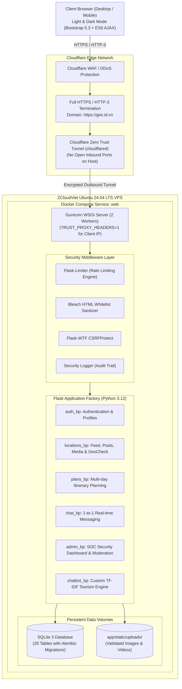

# GetApps (GEs) — "Get Up & Explore"
### Production-Grade Travel Social Network & Multi-Day Itinerary Platform with OWASP Security Hardening

[](https://www.python.org/)
[](https://flask.palletsprojects.com/)
[](https://www.sqlite.org/)
[](https://www.docker.com/)
[](https://www.cloudflare.com/)
[-success?style=for-the-badge&logo=pytest&logoColor=white)](https://docs.pytest.org/)
[](https://owasp.org/)
[](LICENSE)

> 🌐 **Live Production URL:** [https://ges.id.vn](https://ges.id.vn) *(Deployed on Ubuntu 24.04 LTS VPS with Cloudflare Zero Trust Tunnel & HTTPS/HTTP-3)*  
> 📑 **Full Technical Report:** [docs/BaoCao_GetApps_PWD301.pdf](docs/BaoCao_GetApps_PWD301.pdf) *(50+ pages, IEEE reference standard)* | [Google Drive Mirror](https://drive.google.com/drive/folders/1ZbIyrg4yLQVou3FFCKeN_ELbm6z0kWcg?usp=sharing)  
> 📊 **Presentation Slides:** [Google Drive: Slide_GetApps_PWD301.pdf](https://drive.google.com/drive/folders/1ZbIyrg4yLQVou3FFCKeN_ELbm6z0kWcg?usp=sharing) *(High-definition Slides)*

---

## 📖 Executive Summary (Tổng quan Dự án)

**GetApps (GEs)** — *"Get Up & Explore"* là nền tảng mạng xã hội chuyên biệt cho cộng đồng du lịch và khám phá địa phương, tích hợp công cụ lập lịch trình đa chặng (Multi-Day Itinerary Builder) và hệ thống phòng thủ an ninh ứng dụng web toàn diện.

Dự án được nghiên cứu và phát triển trong khuôn khổ đồ án môn học **PWD301 (Web Application Development & Security - Khóa Fall 2026)** tại **Đại học FPT**. Dự án giải quyết trọn vẹn 3 trụ cột:
1. **Trải nghiệm người dùng mượt mà:** Bảng tin đa phương tiện (ảnh/video collage), tương tác thời gian thực (Like, Comment lồng nhau có Emoji Picker, Repost, Bookmark), nhắn tin 1-1 và chuyển đổi giao diện Sáng/Tối (Light/Dark Mode).
2. **Chuẩn hóa dữ liệu địa lý Việt Nam:** Tích hợp bộ dữ liệu hành chính 34 tỉnh/thành và 3.321 phường/xã/đặc khu từ `vietnamese-provinces-database`, hỗ trợ tìm kiếm không dấu (Fuzzy Matching) và thuật toán kiểm chứng tọa độ Google Maps (`geocheck.py`) chống giả mạo địa điểm.
3. **Bảo mật ứng dụng mức doanh nghiệp (Application Security Hardening):** Phòng thủ chủ động trước các mối đe dọa OWASP Top 10 (chống SQLi bằng ORM Parameterization, chống XSS bằng Bleach HTML Sanitizer & Strict CSP, chống CSRF trên toàn bộ Form/AJAX, phòng thủ SSRF khi xử lý liên kết rút gọn, và kiểm soát tần suất truy cập Rate Limiting với cơ chế chống giả mạo IP).

---

## 🏗️ System Architecture (Kiến trúc Hệ thống)

Ứng dụng được thiết kế theo mô hình **Application Factory** dạng module độc lập (Blueprints) đóng gói trong Docker Container và vận hành bền vững sau lớp bảo vệ Cloudflare Edge:



---

## ✨ Key Feature Modules (Các Phân hệ Tính năng)

### 1. 📰 Bảng tin Du lịch & Tương tác Xã hội (Feed & Social Graph)
- **Đa phương tiện (Media Collage):** Tải lên tối đa 10 ảnh/video cho mỗi bài viết. Bố cục hiển thị lưới ảnh thông minh kiểu Facebook (1, 2, 3, 4, 5+ ảnh) kèm Lightbox xem ảnh/video phóng to toàn màn hình.
- **Tương tác sâu:** Thả tim (`Like`), chia sẻ (`Share`: tải ảnh, sao chép liên kết, đăng lại `Repost`), lưu bài viết (`SavedPost`).
- **Bình luận đa cấp (Nested Comments):** Hỗ trợ trả lời bình luận (Reply 1 cấp lồng nhau), nhắc tên `@mention`, thả tim bình luận và tích hợp **Bảng chọn Emoji Picker** trực quan.
- **Hashtag động:** Thanh trượt ngang Top 10 Hashtag thịnh hành nhất trích xuất tự động từ cơ sở dữ liệu kèm nút thêm hashtag tùy chỉnh không trùng lặp.

### 2. 🗺️ Lập Lịch trình Du lịch Thông minh (Multi-day Itinerary Planner)
- **Quản lý hành trình chi tiết:** Lập kế hoạch theo từng ngày (Ngày 1, Ngày 2...), tính toán tổng số ngày và tự động cộng dồn chi phí dự kiến từ các chặng.
- **Phân loại điểm dừng chuyên biệt:** Mỗi chặng dừng hỗ trợ gắn nhãn loại hình (`Ăn uống`, `Tham quan`, `Nghỉ ngơi`), giờ mở cửa, món ăn gợi ý, phương tiện di chuyển và liên kết Google Maps.
- **Quản lý lưu trú:** Khối thông tin khách sạn/homestay theo ngày, giờ nhận/trả phòng, giá phòng và liên kết đặt phòng an toàn.

### 3. 📍 Chuẩn hóa Địa giới Hành chính Việt Nam (`places.py`)
- Tích hợp bộ dữ liệu chuẩn **34 tỉnh/thành phố và 3.321 phường/xã/đặc khu** theo Nghị quyết `388/NQ-UBTVQH16` từ `vietnamese-provinces-database` [1].
- **Fuzzy Search & Aliases:** Thuật toán tìm kiếm không dấu, bắt lỗi chính tả (`SequenceMatcher` ratio $\ge 0.85$) và tự động ánh xạ các địa danh du lịch nổi tiếng (*Đà Lạt, Sa Pa, Phú Quốc, Côn Đảo, Hội An...*) hoặc tên tỉnh cũ về đúng đơn vị hành chính mới.
- **Lazy Seeding:** Tự động đồng bộ và sinh bản ghi cấp bậc Cha–Con (`parent_id`) trong bảng `locations` khi người dùng lựa chọn.

### 4. 💬 Trò chuyện Riêng tư & Thông báo (Chat & Notifications)
- Nhắn tin 1-1 thời gian thực giữa các tài khoản, hỗ trợ gửi tệp đính kèm an toàn lưu ngoài thư mục public (`instance/chat_uploads/`).
- Quản lý trạng thái hội thoại: `mutual` (bạn bè follow nhau), `pending` (tin nhắn chờ từ người lạ), chấp nhận/từ chối hội thoại, và thu hồi tin nhắn.
- Hệ thống thông báo tự động khi có tương tác mới (Like, Comment, Follow, Repost).

### 5. 🛡️ Bảng điều khiển Quản trị & Giám sát An ninh (Admin SOC Dashboard)
- Giám sát toàn bộ hoạt động hệ thống theo thời gian thực (múi giờ `UTC+7` Việt Nam).
- **Security Logs:** Tự động bắt và phân loại các sự kiện an ninh (`DDOS_RATE_LIMIT`, `BRUTE_FORCE_AUTH`, `SQLI_DETECTED`, `XSS_DETECTED`, `ACCESS_DENIED_403`).
- Quản trị nội dung: Kiểm duyệt bài viết/lịch trình nghi vấn, khóa tài khoản (`is_banned`), theo dõi đặc biệt (`is_watched`), và cơ chế xóa dây chuyền an toàn (Cascade Delete).

---

## 🔒 Application Security Engineering (Kỹ thuật Bảo mật - Trọng tâm PWD301)

Dự án được xây dựng với tư duy **Security by Design** nhằm triệt tiêu các nguy cơ thuộc **OWASP Top 10:2021** [3]:

| Lỗ hổng OWASP | Kỹ thuật Phòng thủ & Triển khai trong Mã nguồn | Trạng thái |
| :--- | :--- | :---: |
| **A01: Broken Access Control** | • Decorator `@admin_required` và `@login_required` phân tách triệt để giữa quyền Admin thật (`is_admin`) và nhãn hiển thị cộng đồng (`role`).<br>• Kiểm tra quyền sở hữu đối tượng (Object-level IDOR Check) trên mọi thao tác Sửa/Xóa bài viết, lịch trình, bình luận, tin nhắn.<br>• Chặn truy cập bài viết/lịch trình đặt quyền riêng tư (`visibility = 'private'`). | ✅ Đã vá & Kiểm thử |
| **A02: Cryptographic Failures** | • Băm mật khẩu người dùng bằng thuật toán an toàn `PBKDF2-SHA256` / `scrypt` qua thư viện `Werkzeug.security`.<br>• Secret Key và JWT Secret Key được quản lý độc lập qua biến môi trường `.env`.<br>• Toàn bộ kết nối bên ngoài bắt buộc qua HTTPS/TLS 1.3 và HSTS (`max-age=31536000`). | ✅ Đã vá & Kiểm thử |
| **A03: Injection (SQLi & Command)** | • 100% câu truy vấn CSDL sử dụng **SQLAlchemy Parameterized Queries (ORM)**, tuyệt đối không nối chuỗi SQL thô.<br>• Bộ lọc Regex trong `app/security_logging.py` phát hiện sớm các mẫu ký tự bất thường (`UNION SELECT`, `' OR 1=1 --`) để ghi log cảnh báo và chặn tấn công. | ✅ Đã vá & Kiểm thử |
| **A03: Stored & Reflected XSS** | • Sử dụng **`Bleach 6.4.0`** lọc trắng (Whitelist Tag/Attribute Sanitization) toàn bộ văn bản đầu vào trước khi lưu CSDL.<br>• Jinja2 Context-Aware Auto-Escaping mặc định.<br>• Thiết lập Content Security Policy (CSP) chặt chẽ, loại bỏ `unsafe-inline` không cần thiết. | ✅ Đã vá & Kiểm thử |
| **A04: Insecure Design & Spoofing** | • **Geospatial Anti-Spoofing (`geocheck.py`):** Kiểm tra tọa độ GPS trong link Google Maps đối chiếu với Bounding Box của tỉnh đã chọn (dung sai 15km cho bài viết, 80km cho lịch trình), tự động gắn cờ `mismatch` để Admin kiểm duyệt.<br>• **SSRF Protection:** Khi giải mã liên kết rút gọn `maps.app.goo.gl`, hệ thống chặn phân giải IP nội bộ / Loopback (`127.0.0.1`, `10.x`, `169.254.x`) và giới hạn tối đa 4 bước chuyển hướng.<br>• **Magic-Byte Media Validation:** Kiểm tra chữ ký byte thực của file ảnh/video, chặn tuyệt đối việc đổi đuôi file và chặn file `.svg` chứa mã độc XML/XSS. | ✅ Đã vá & Kiểm thử |
| **A05: Security Misconfiguration** | • Cấu hình đầy đủ Security Headers: `X-Frame-Options: SAMEORIGIN`, `X-Content-Type-Options: nosniff`, `Referrer-Policy: same-origin`.<br>• Ẩn hoàn toàn thông tin phiên bản máy chủ (Server Fingerprint Hardening). | ✅ Đã vá & Kiểm thử |
| **A07: Identification & Auth Failures** | • Chính sách mật khẩu mạnh: tối thiểu 8 ký tự, bao gồm chữ hoa, chữ thường và ký tự đặc biệt.<br>• Session Cookie có cờ `HttpOnly`, `SameSite=Lax`.<br>• Hệ thống Rate Limiting siết chặt tần suất dò mật khẩu và tấn công Brute-force. | ✅ Đã vá & Kiểm thử |
| **A09: Security Logging & Monitoring** | • Bảng `security_logs` ghi nhận vết kiểm toán chi tiết (IP thật, loại sự kiện, endpoint, mã trạng thái, User-Agent).<br>• **Privacy-Preserving:** Tự động làm sạch dữ liệu (Sanitize Payload), tuyệt đối không lưu mật khẩu thật hoặc token nhạy cảm vào log. | ✅ Đã vá & Kiểm thử |

---

### 🚦 Bảng Cấu hình Giới hạn Tần suất (Rate Limiting Policy)

Hệ thống tích hợp `Flask-Limiter` [8] với chiến lược `"fixed-window"`. Hàm `get_client_ip()` trong [`app/extensions.py`](app/extensions.py) xử lý chuẩn xác IP thật qua biến môi trường `TRUST_PROXY_HEADERS=1`, **ngăn chặn hoàn toàn lỗ hổng giả mạo IP (`IP Spoofing`)** bằng header giả:

| Endpoint | Giới hạn (Rate Limit) | Mục tiêu Bảo vệ |
| :--- | :---: | :--- |
| `POST /login`, `POST /api/login` | **`5/phút; 20/giờ`** | Chặn đứng tấn công Brute-force vét cạn mật khẩu và Password Spraying (khóa ngay từ **lần thứ 6**). |
| `POST /register` | **`5/phút; 15/giờ`** | Ngăn chặn bot tự động đăng ký tài khoản rác ồ ạt làm tràn dữ liệu. |
| `POST /forgot-password` | **`3/phút; 10/giờ`** | Chống spam gửi email đặt lại mật khẩu và làm cạn kiệt tài nguyên máy chủ. |
| `POST /resend-otp` | **`3/phút; 10/giờ`** | Chống lạm dụng gửi mã xác thực OTP liên tục. |
| `POST /change-password`, `/reset-password` | **`5/phút`** | Chặn vét cạn mã OTP và brute-force đổi mật khẩu. |
| `POST /locations/upload` | **`10/phút`** | Chống tấn công DoS làm đầy dung lượng ổ đĩa qua tải lên ảnh/video liên tục. |
| `GET /search` | **`45/phút`** | Chống hành vi cào quét dữ liệu người dùng và nội dung (Scraping). |
| `GET /search/suggest` | **`60/phút`** | Chống tấn công làm quá tải tài nguyên máy chủ qua truy vấn gợi ý. |
| `Toàn bộ Endpoint khác (Global Default)` | **`200/phút; 2000/giờ`** | Ngăn chặn DoS / HTTP Request Flooding ở tầng ứng dụng (L7). |

---

## 🗄️ Database Architecture (26 Tables)

Cơ sở dữ liệu được quản lý qua SQLAlchemy ORM với **26 bảng vật lý**:

```
instance/app.db
├── Core User & Social (5): users, follows, conversations, messages, message_reactions
├── Posts & Media (6):      posts, photos, locations, post_extra_locations, hashtags, post_hashtags
├── Multi-Day Plans (5):    itineraries, itinerary_days, itinerary_stops, itinerary_lodgings, itinerary_attachments
├── Engagement XOR (6):     likes, comments, comment_likes, shares, saved_posts, notifications
├── Security & GIS (3):     security_logs, map_links, ges_places
└── Migrations (1):         alembic_version
```

> **Thiết kế độc đáo — Ràng buộc XOR đối tượng (`CheckConstraint`):**  
> Các bảng tương tác chung (`likes`, `comments`, `shares`, `saved_posts`, `map_links`) hỗ trợ đồng thời cả Bài viết (`post_id`) và Lịch trình (`itinerary_id`) bằng ràng buộc toàn vẹn dữ liệu:
> ```sql
> CHECK ((post_id IS NOT NULL) != (itinerary_id IS NOT NULL))
> ```
> Đảm bảo mỗi lượt tương tác chỉ gắn với đúng một đối tượng duy nhất, loại bỏ trùng lặp và phân mảnh bảng.

---

## 🧪 Automated Testing & Quality Assurance (151/151 Passed)

Dự án áp dụng quy trình kiểm thử tự động toàn diện bằng `pytest` [4], bao phủ toàn bộ luồng nghiệp vụ và kịch bản bảo mật:

```bash
$ pytest -q --disable-warnings
........................................................................ [ 47%]
........................................................................ [ 95%]
.......                                                                  [100%]
======================== 151 passed, 641 warnings in 106.75s ========================
```

- `tests/test_auth.py` & `test_auth_frontend.py`: Xác thực tài khoản, phiên làm việc, CSRF, đăng nhập Google OAuth.
- `tests/test_locations.py` & `test_frontend.py`: Đăng bài nhiều ảnh, bình luận lồng nhau, thả tim, repost, lightbox.
- `tests/test_plans.py`: Quy trình tạo lịch trình nhiều ngày, tính chi phí, phân loại chặng ăn uống/tham quan.
- `tests/test_rate_limiting.py`: **8 kịch bản** kiểm thử siết chặt giới hạn tần suất, chặn đứng từ lần vi phạm thứ 6 kể cả khi đổi IP giả lập.
- `tests/test_admin.py` & `test_security.py`: Thử nghiệm payload SQLi (`' OR 1=1`), XSS `<script>`, xác thực chữ ký ảnh và quyền Admin SOC.

---

## 🚀 Quick Start & Installation (Hướng dẫn Chạy thử)

### Cách 1: Chạy nhanh bằng Docker Compose (Khuyên dùng)
```bash
# 1. Clone repository
git clone https://github.com/<your-username>/GetApps.git
cd GetApps

# 2. Tạo file cấu hình môi trường
cp .env.example .env

# 3. Khởi chạy toàn bộ hệ thống bằng Docker
docker compose up -d --build

# 4. Truy cập ứng dụng
open http://localhost:5000
```

### Cách 2: Chạy trực tiếp với môi trường ảo Python
```bash
# 1. Khởi tạo môi trường ảo Python 3.12
python -m venv venv
# Trên Windows:
.\venv\Scripts\Activate.ps1
# Trên Linux/macOS:
source venv/bin/activate

# 2. Cài đặt các thư viện phụ thuộc
pip install -r app/Report/requirements.txt

# 3. Thiết lập biến môi trường và Migration CSDL
cp .env.example .env
flask --app run db upgrade

# 4. Khởi chạy máy chủ phát triển
python run.py
```

---

## 👥 Đội ngũ Phát triển & Phân chia Trách nhiệm (Team Attribution)

Dự án được nghiên cứu và phát triển bởi **Nhóm 03 — Lớp IA2007, Môn PWD301, Đại học FPT**:

| STT | Họ và tên | Mã sinh viên (MSSV) | Vai trò & Phụ trách chuyên môn chính |
| :-: | :--- | :---: | :--- |
| **1** | **Võ Quốc Khánh** | **SE203038** | **Nhóm trưởng** — Kiến trúc Backend & Frontend; Quản trị Admin SOC Dashboard, Phân quyền truy cập (RBAC / Broken Access Control), Triển khai Cloud & Production. |
| **2** | **Vũ Hoàng Tuấn** | **SE201607** | **Backend Developer** — Thiết kế và tối ưu CSDL quan hệ, Module Bài viết & Tương tác, Phòng chống SQL Injection và chuẩn hóa dữ liệu đầu vào. |
| **3** | **Phạm Đồng Thanh Trúc** | **SE201580** | **Backend & Security** — Phòng chống XSS bằng Bleach Sanitizer, Thiết lập Content Security Policy (CSP), Kiểm soát an toàn tải lên tệp tin đa phương tiện. |
| **4** | **Nguyễn Thị Kiều Vy** | **SE205080** | **UI/UX Designer** — Thiết kế hệ thống nhận diện thương hiệu GEs, Prototype giao diện người dùng, Bố cục Feed và Trang cá nhân responsive. |
| **5** | **Nguyễn Tấn Phát** | **SE173285** | **Frontend & Security** — Xây dựng giao diện tương tác (Dark/Light mode, Emoji picker), Nghiên cứu và hiện thực hóa Rate Limiting chống DDoS/Brute-force, Giám sát nhật ký an ninh. |

---

## 📑 Tài liệu Đính kèm (Project Documentation)

- 📘 **Báo cáo Kỹ thuật Đầy đủ (Technical Report):** [docs/BaoCao_GetApps_PWD301.pdf](docs/BaoCao_GetApps_PWD301.pdf) *(Báo cáo đồ án 50+ trang, trình bày chi tiết kiến trúc, phân tích mã nguồn và thực nghiệm an toàn thông tin).*  
  *(Bản dự phòng trên Cloud: [Google Drive Folder](https://drive.google.com/drive/folders/1ZbIyrg4yLQVou3FFCKeN_ELbm6z0kWcg?usp=sharing))*
- 📽️ **Slide Thuyết trình Đồ án (Presentation Slide):** [Google Drive: Slide_GetApps_PWD301.pdf](https://drive.google.com/drive/folders/1ZbIyrg4yLQVou3FFCKeN_ELbm6z0kWcg?usp=sharing) *(Slide bảo vệ trước Hội đồng chấm thi Đại học FPT, lưu trữ chất lượng cao trên Google Drive).*

---

## 📚 Nguồn Tham khảo & Trích dẫn Học thuật (IEEE References)

Toàn bộ tài liệu tham khảo và bộ dữ liệu nguồn được trích dẫn theo chuẩn học thuật IEEE tương ứng với Báo cáo kỹ thuật của dự án:

- **[1]** T. L. Quoc, *Vietnamese Provinces Database (v5.2.0) — Cơ sở dữ liệu đơn vị hành chính Việt Nam cập nhật theo Nghị quyết 388/NQ-UBTVQH16*, GitHub Repository, 2025. [Trực tuyến]. Địa chỉ: [https://github.com/thanglequoc/vietnamese-provinces-database](https://github.com/thanglequoc/vietnamese-provinces-database) (Giấy phép MIT). [Truy cập: 15/10/2026].
- **[2]** OpenStreetMap Contributors và Overture Maps Foundation, *Planet Dump Vietnam (vietnam-261020.osm.pbf) & Overture Places Dataset*, OpenStreetMap Foundation, 2026. [Trực tuyến]. Địa chỉ: [https://www.openstreetmap.org](https://www.openstreetmap.org) và [https://overturemaps.org](https://overturemaps.org) (Giấy phép ODbL). [Truy cập: 20/10/2026].
- **[3]** OWASP Foundation, *OWASP Top 10:2021 — The Ten Most Critical Web Application Security Risks & OWASP Cheat Sheet Series (SQL Injection, XSS, CSRF, Access Control)*, Open Web Application Security Project, 2021. [Trực tuyến]. Địa chỉ: [https://owasp.org/www-project-top-ten/](https://owasp.org/www-project-top-ten/). [Truy cập: 18/10/2026].
- **[4]** Pallets Projects, *Flask Web Development Framework Documentation (v3.x)*, Pallets, 2026. [Trực tuyến]. Địa chỉ: [https://flask.palletsprojects.com/](https://flask.palletsprojects.com/). [Truy cập: 10/10/2026].
- **[5]** M. Bayer và Cộng sự, *SQLAlchemy 2.0 Documentation — The Database Toolkit for Python & Flask-Migrate (Alembic)*, SQLAlchemy Project, 2026. [Trực tuyến]. Địa chỉ: [https://docs.sqlalchemy.org/](https://docs.sqlalchemy.org/). [Truy cập: 10/10/2026].
- **[6]** M. Countryman và Pallets Community, *Flask-Login Documentation — User Session Management for Flask*, Read the Docs, 2026. [Trực tuyến]. Địa chỉ: [https://flask-login.readthedocs.io/](https://flask-login.readthedocs.io/). [Truy cập: 12/10/2026].
- **[7]** H. Le và WTForms Team, *Flask-WTF Documentation — Simple Integration of Flask and WTForms with CSRF Protection*, Read the Docs, 2026. [Trực tuyến]. Địa chỉ: [https://flask-wtf.readthedocs.io/](https://flask-wtf.readthedocs.io/). [Truy cập: 12/10/2026].
- **[8]** A. Akber, *Flask-Limiter Documentation (v4.1.1) — Rate Limiting for Flask Applications*, Read the Docs, 2026. [Trực tuyến]. Địa chỉ: [https://flask-limiter.readthedocs.io/](https://flask-limiter.readthedocs.io/). [Truy cập: 18/10/2026].
- **[9]** Trung tâm Internet Việt Nam (VNNIC) — Bộ Thông tin và Truyền thông, *Chương trình phổ cập tên miền quốc gia .id.vn dành cho công dân Việt Nam*, VNNIC, 2026. [Trực tuyến]. Địa chỉ: [https://tenmien.vn/](https://tenmien.vn/). [Truy cập: 20/10/2026].
- **[10]** ZCloudViet và Cloudflare, Inc., *Dịch vụ Máy chủ đám mây ZCloudViet (Cloud Standard Ubuntu 24.04 LTS) & Tài liệu Cloudflare Zero Trust Tunnel (cloudflared)*, 2026. [Trực tuyến]. Địa chỉ: [https://zcloudviet.com/](https://zcloudviet.com/) và [https://developers.cloudflare.com/cloudflare-one/](https://developers.cloudflare.com/cloudflare-one/). [Truy cập: 22/10/2026].

---

## 📄 License

Dự án được phân phối dưới giấy phép **MIT License**. Xem chi tiết tại [LICENSE](LICENSE).  
Bản quyền dữ liệu hành chính Việt Nam thuộc về `thanglequoc/vietnamese-provinces-database` theo giấy phép MIT.  
Bản quyền dữ liệu bản đồ thuộc về các nhà đóng góp © OpenStreetMap và Overture Maps Foundation theo giấy phép ODbL.
